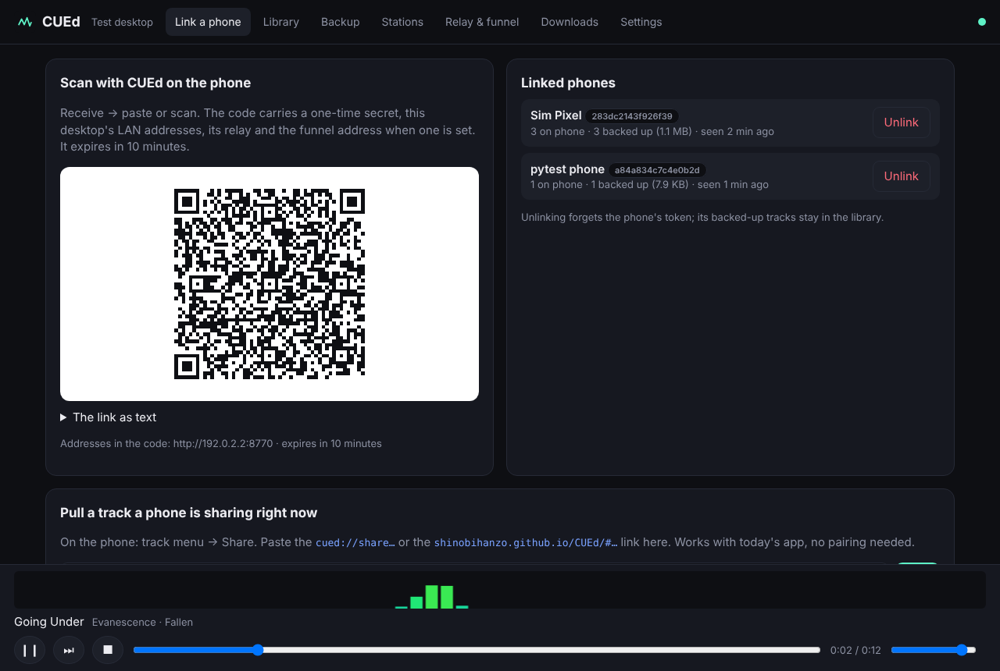
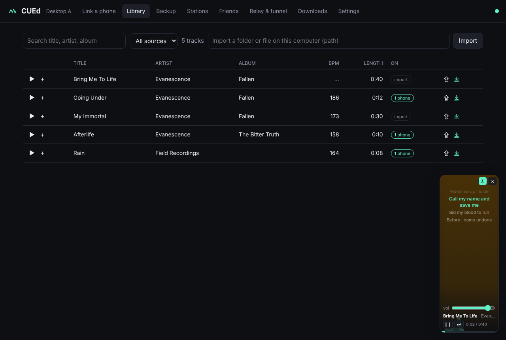
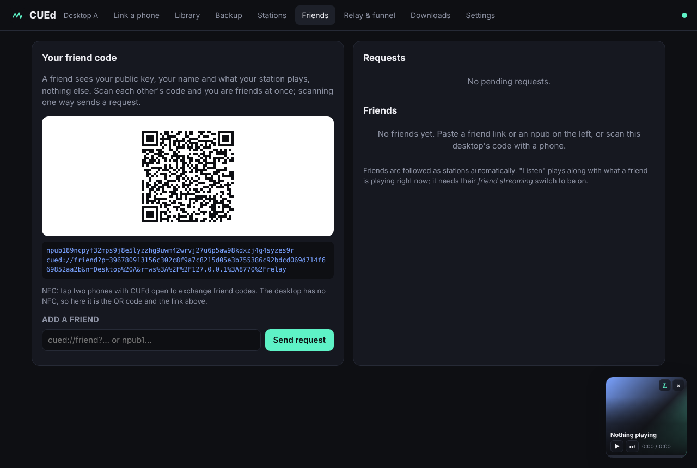
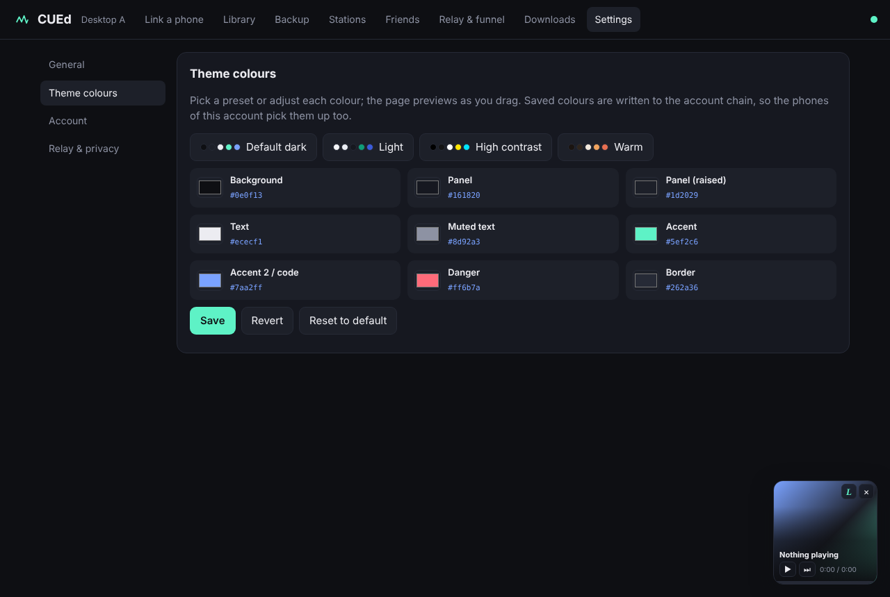
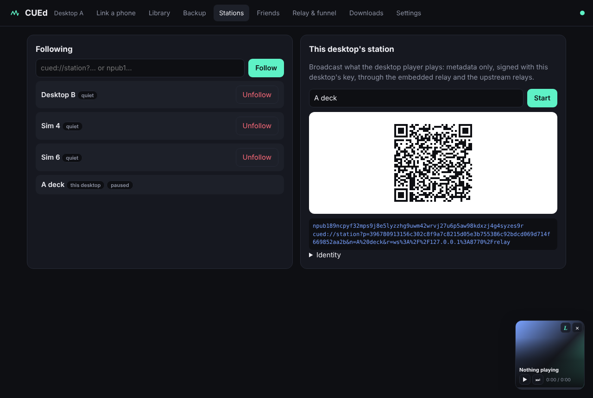
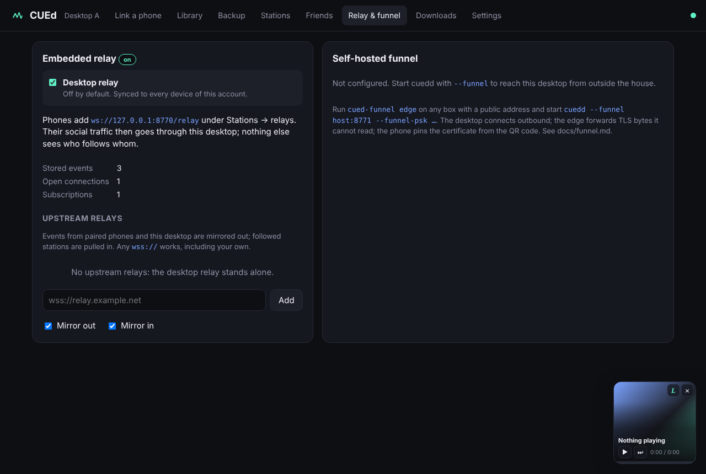

# CUEd desktop

The computer-side half of [CUEd](https://github.com/ShinobiHanzo/CUEd), the offline-first Android
music player. Pair the phone with a QR code and the desktop becomes its **backup**, its **library
server**, its **download box** and its **relay to the world**, without an account, a cloud or a
third party anywhere in the path.

```
phone ──Wi-Fi──▶ cuedd (this)  ◀──your own funnel edge──  phone, from anywhere
                 ├─ backs up the phone's tracks (content-addressed, resumable)
                 ├─ streams its library back to the phone or any browser
                 ├─ pushes a track to any phone with today's CUEd through a share QR
                 ├─ runs spotdl downloads for the phone's "Companion (LAN)" backend
                 ├─ embeds a Nostr relay: the phone's Stations traffic goes through you
                 ├─ follows and hosts Stations itself, mirrored to relays you choose
                 └─ plays with a real two-deck crossfade, spectrograph and BPM detection
```

Three languages, each where it earns its place:

| Part | Language | Why |
|---|---|---|
| `crates/cuedd`, `cued-proto`, `cued-relay`, `cued-funnel` | Rust | one static binary, async networking, the same BIP-340 signatures as the phone, no runtime to install |
| `native/cued-audio` | C++17 | the audio engine: decoding, two decks, crossfade curves, FFT, BPM; ports the phone's `core/dsp` and `core/mix` maths line for line, driven by [miniaudio](https://miniaud.io) (vendored, dlopen-based, no system audio headers needed) |
| `python/cued_companion` | Python | the download worker around `spotdl` (the phone already speaks its API), a phone simulator for testing, and pure-Python codecs you can read in an afternoon |

## What it looks like

| Link a phone | Library, mini player expanded with synced lyrics |
|---|---|
|  |  |
| **Friends** | **Theme colours** |
|  |  |
| **Stations** | **Relay & funnel** |
|  |  |

## Quick start

```bash
# build everything (Rust toolchain, a C++17 compiler and Python 3.9+ are the only requirements)
cargo build --release
python3 -m pip install spotdl            # for downloads; optional

# run
./target/release/cuedd --open            # UI at http://127.0.0.1:8770, phones use http://<your LAN ip>:8770
```

Then on the desktop UI → **Link a phone** → *Show a pairing code*, and on the phone CUEd → Receive →
scan. From then on the phone can sync, stream and back up; see `docs/protocol.md` for exactly what
crosses the wire.

**Today's CUEd app** (before it learns `cued://pair`) already works with two things here: the
desktop pulls a track from the phone's Share screen (paste the share link under *Link a phone*), and
the desktop pushes a track to the phone with the ⇪ button in *Library* (the phone's Receive screen
scans it). The companion download API is unchanged, so Downloads → Backend → Companion (LAN) →
`http://<desktop>:8770` works as is. Point the phone's Stations relays at
`ws://<desktop>:8770/relay` and its social traffic goes through your box.

## Reach it from outside the house: the funnel

```bash
cued-funnel keygen                                   # a pre-shared key
cued-funnel edge --listen 0.0.0.0:443 --control 0.0.0.0:8771 --psk <key>   # on a $3 VPS or a Pi with a forwarded port
cuedd --funnel vps.example.net:8771 --funnel-psk <key> --funnel-public vps.example.net:443
```

The desktop dials **out** to the edge; nothing is opened at home. The edge forwards TLS bytes it
cannot read; the certificate is made on the desktop and its fingerprint rides in the pairing QR, so
the phone pins it. `docs/funnel.md` has the details and the threat model.

## Layout

```
crates/cued-proto     share / station / pair links, Nostr events, npub/nsec        (tested against the phone's BIP-340 vectors)
crates/cued-relay     embedded NIP-01 relay on SQLite                              (replaceable kinds, filters, live push)
crates/cued-funnel    self-hosted funnel: edge binary, client, TLS forwarder       (mux over one outbound TCP connection)
crates/cued-audio     Rust bindings to the C++ engine (built by cargo through `cc`)
crates/cuedd          the daemon: HTTP API, SQLite library, pairing, sync, backup, streaming, stations, companion bridge, web UI
native/cued-audio     C++ engine + CMake tests + `cued-audio analyse` CLI
python/cued_companion spotdl worker, phone simulator, codecs, pytest suite
ui/                   the web UI (vanilla HTML/CSS/JS, embedded into cuedd at build time)
docs/                 protocol, architecture, funnel, building
```

## Testing

```bash
cargo test                                            # Rust: proto, relay, funnel, audio bindings, daemon
cmake -S native/cued-audio -B build/audio && cmake --build build/audio && ctest --test-dir build/audio
cd python && python3 -m pytest -q                    # Python
cued-phone-sim pair "<link from the UI>" && cued-phone-sim sync ~/Music   # end to end, no Android needed
```

## Who may do what

Three tiers, enforced before any handler runs (`docs/protocol.md` §7): the UI on localhost is
admin; a paired phone on a private address writes with its token; from the funnel the desktop is
**read-only** and each read needs a biometric assertion the phone signs with a Keystore key it
cannot use without a fingerprint or face. The desktop relay is **off by default** and the switch
syncs to every device of the account.

## Accounts, friends, listening in

An account is one secp256k1 key carried on a small signed chain, so you can scan the same
pairing code on another computer and choose to join, keep or separate (`docs/protocol.md` §8).
Friends are public keys exchanged over `cued://friend` QR or NFC links, or carried inside a share
link with the "send a friend request" toggle (§9). A friend's station is metadata only, current
track plus the next three; with *friend streaming* on, listeners pull temporary copies from the
host's desktop and stay within a few seconds, keeping thumbnails, lyrics and metadata for 48
hours (§10). Theme colours live in the account chain too, so your phones match the desktop.

## Ledger, party, karaoke (0.3.0)

- **Ledger** tab: your listening, counted on the box: plays, hours, discoveries, streaks, the hour-of-day
  shape, top artists / tracks / albums / genres; export the raw log as JSON you own.
- **Party** (Friends tab): friends on the Wi-Fi find the desktop over a UDP beacon and queue songs from
  its library with signed requests; only your friends list gets through. `python -m cued_companion.party`
  is a command-line guest.
- **Karaoke**: the K button on the mini player cuts the lead vocal and keeps the bass.

## Updates

`cuedd` updates itself the way a self-hosted thing should: it looks at this repository's Releases for its
own platform, downloads the next archive in the background, checks it against the published SHA-256
and keeps it staged under `<data>/updates/`. It never swaps binaries while running on its own: the
staged version installs on the next launch (or on *Install now and restart* in Settings → General →
Updates), the previous binary stays as `cuedd.old`, and the first page load afterwards shows the patch
notes from `CHANGELOG.md`. Turn the automatic download off in the same card; unpacking an archive by
hand keeps working as before.

## Status

Third cut (0.3.1). Everything above runs and is tested on Linux; the UI is a web page served by the daemon,
which is what makes it work on an old laptop or a Pi next to the router. A native window (webview)
and a tray icon are the obvious next step. The phone app still has to learn the `cued://pair` link
and the sync calls (`docs/protocol.md` §2–3 is the spec; the phone repo's `docs/desktop.md` tracks
that work). What works with the phone *as shipped today* is marked above.

## License

MIT, like CUEd. miniaudio is public domain / MIT-0 (see `native/cued-audio/third_party`).
